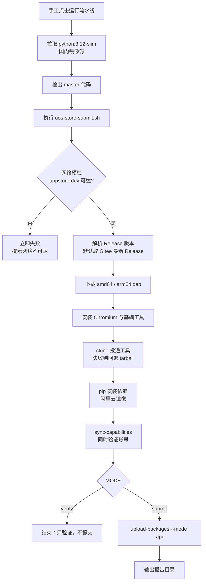

# 统信应用商店投递迁移到 Gitee Go 设计

> 2026-10-07 补充：维护者已选择并实测「本地直接读取 GitHub Release → 提交商店」；
> 后续本地发布优先按第 10 节执行。第 1～9 节保留原 Gitee Go 方案及历史背景。

## 1. 背景与问题

release 流程里有一个「自动把最新版本投递到统信应用商店」的环节，原先放在
GitHub Actions 的 `release.yml` 的 `update-uos-store` 任务中，调用第三方工具
`guanzi008/appstore` 完成提交。该任务在 GitHub Actions 上长期失败，原因不是账号
或包的问题，而是**网络链路**：

- 投递工具访问的商店开放平台是 `https://appstore-dev.uniontech.com`，属于国内服务；
- 工具的登录环节必须使用**无头 Chromium**（内部用 pyppeteer 打开登录页、输入账号、
  再把 Cookie / localStorage 导出给 requests 会话复用），不是纯 HTTP 登录；
- GitHub Actions 的运行器在境外，访问该平台的链路不可用，任务必然失败。

结论：这个环节要有国内出口的构建环境才能跑通。

## 2. 方案选型

| 方案 | 结论 | 原因 |
| --- | --- | --- |
| A. Gitee Go 云端容器（`execute@docker`） | **采用** | 构建节点在国内，能访问商店平台；每月有免费核分额度，够低频发版使用 |
| B. Gitee Go「主机纳管」跑在自有机器 | 否决 | 需要机器可被 Gitee 侧 SSH 接入，家用/办公网络不满足；且依赖个人机器在线 |
| C. 自建带 Chromium 的镜像并推到国内仓库 | 暂缓 | 更稳定，但需要额外维护镜像仓库；当前先用公共镜像 + 容器内安装 |
| D. 取消 CI，改本地脚本手工执行 | 否决 | 发版流程需要可追溯、可重复，手工执行容易漏步骤 |

## 3. 关键实测结论

以下结论均来自在 Gitee Go 上真实运行探测流水线得到的日志，不是推测：

1. **Docker Hub 不可用**：`image: "alpine:3.19"` 直接报
   `Back-off pulling image "alpine:3.19"`，Gitee Go 的构建节点无法直连 Docker Hub。
   改用国内镜像源 `docker.m.daocloud.io` 后可以正常拉取。
2. **容器是 root**，且 `apt-get` 可用（Debian 系镜像），因此可以在容器内安装
   Chromium 与运行库。
3. **网络可达性**（按探测顺序，1 表示可达）：
   - `appstore-dev.uniontech.com` 可达（这是本方案成立的前提）；
   - `gitee.com`、`github.com` 可达；
   - 官方 PyPI、Google 系域名不可达，必须显式使用国内镜像。
4. **流水线配置随代码版本化**：Gitee Go 会把流水线定义存成仓库内的
   `.workflow/<name>.yml`；反过来，直接往仓库 `.workflow/` 丢一个合法 YAML，
   Gitee Go 也会自动识别成流水线。因此配置文件可以放仓库、随 GitHub → Gitee 同步。
5. **手工触发可用**，且 `triggers` 段可以省略，从而避免 push 自动触发——
   这一点很重要：这条流水线会真实提交商店，不能被日常提交误触发。

## 4. 架构与文件职责

```
.workflow/uos-store-upload.yml        ← 薄壳：拉镜像 + 调用脚本（手工触发）
build/scripts/uos-store-submit.sh     ← 全部业务逻辑（下载产物、备环境、投递）
Gitee Go「通用变量」                    ← APPSTORE_USERNAME / APPSTORE_PASSWORD
Gitee Release 资产                     ← linglong-store_<版本>_{amd64,arm64}.deb
```

分层原则：**配置进仓库、逻辑进脚本、凭据进变量**。

- 流水线 YAML 只做转发，不做业务判断，改一行即懂；
- 脚本可以在本地用同样参数复现，便于排查；
- 凭据永不进仓库，只通过 Gitee Go 通用变量注入，密码使用「密文」类型。

## 5. 运行流程



`MODE` 是防止误提交的开关：脚本默认 `verify`，只有流水线显式传入 `submit`
才真正提交。因此「调试用流水线」和「正式提交流水线」是文件级隔离的。

## 6. 变量与凭据

| 名称 | 来源 | 说明 |
| --- | --- | --- |
| `APPSTORE_USERNAME` | Gitee Go 通用变量 | 商店开发者账号 |
| `APPSTORE_PASSWORD` | Gitee Go 通用变量（密文） | 商店开发者密码 |
| `RELEASE_TAG` | 可选变量 | 指定投递版本，留空取 Gitee 最新 Release |
| `MODE` | 流水线内写死 | `verify` / `submit` |
| `GITEE_REPO` | 脚本默认值 | 存放 deb 产物的仓库 |
| `APPSTORE_TOOL_REPO` | 脚本默认值 | 投递工具来源，日后可换 Gitee 私有镜像仓库 |
| `PIP_INDEX_URL` | 脚本默认值 | PyPI 镜像，默认阿里云 |

通用变量需要**在流水线编辑页显式关联**才会注入构建环境，创建变量本身不等于生效。

## 7. 操作手册

首次配置：

1. 确认 Gitee 仓库已开通 Gitee Go 流水线（仓库页面「流水线」入口可进入即可）；
2. 在「通用变量」中添加 `APPSTORE_USERNAME`、`APPSTORE_PASSWORD`（密码勾选密文）；
3. 打开 `ustore-store-upload` 流水线（由 `.workflow/uos-store-upload.yml` 自动出现），
   在编辑页关联上述两个变量并保存；
4. 确认目标版本的 Gitee Release 已包含 amd64 / arm64 的 deb 资产。

每次发版：

1. 走完既有 release 流程，产物同步到 Gitee Release；
2. 打开流水线页面，点「运行」；
3. 观察日志：`sync-capabilities` 通过表示账号与网络正常；`upload-packages` 输出报告
   表示提交成功。

## 8. 边界与风险

- **工具无 LICENSE**：`guanzi008/appstore` 仓库未声明开源许可，因此不能把它的代码
  复制进本仓库；当前采用运行时 clone（可切换到自建 Gitee 私有镜像仓库）。若后续要
  内置，需要先与作者确认授权。
- **Chromium 依赖较重**：每次运行都要在容器内准备 Chromium，首次运行较慢；
  若后续想提速，可自建预装 Chromium 的镜像并推到国内仓库。
- **凭据轮换**：商店密码变更后只需改 Gitee Go 通用变量，不需要改代码。
- **不自动触发**：流水线不做 push/tag 自动触发，避免把未验证的产物提交到商店。

## 9. 验证清单

- [ ] 容器能拉取 `docker.m.daocloud.io` 镜像
- [ ] `appstore-dev.uniontech.com` 预检通过
- [ ] deb 产物下载成功且非空
- [ ] Chromium 可用，`sync-capabilities` 登录成功
- [ ] `MODE=verify` 运行不会产生任何提交
- [ ] `MODE=submit` 能产出报告并完成提交

## 10. 本地直接发布：已跑通的快速路径

### 10.1 下次给编码助手的指令

> 将 GitHub Release `vX.Y.Z` 的 amd64、arm64、loong64 DEB 发布到 UOS 商店。
> 按 `docs/53-uos-store-gitee-go-design.md` 第 10 节在本地执行，不走 Gitee，
> 从 `private.env` 读取商店凭据，复用现有 Python 环境、Chrome 和投递工具。
> 更新说明依据该 Release 整理；校验 SHA256 后直接提交，并回读版本、更新说明
> 和审核状态，保存报告。若已提交同一版本，先核对商店状态，避免重复提审。

### 10.2 已准备好的环境与业务边界

| 项目 | 本机已验证配置 |
| --- | --- |
| 工作目录 | `/home/han/code/linglong-store/flutter-linglong-store` |
| Release 仓库 | `HanHan666666/flutter-linglong-store` |
| 商店应用 | `玲珑应用商店社区版`，包名 `linglong-store`，应用 ID `1096239` |
| 凭据 | 根目录 `private.env` 的 `APPSTORE_USERNAME`、`APPSTORE_PASSWORD`；Git 忽略，权限 `0600` |
| Python 环境 | `build/uos-store/3.7.0/venv/bin/python3`，Python 3.12，依赖已安装 |
| 投递工具 | `build/uos-store/3.7.0/appstore-tool`，来源 `https://github.com/guanzi008/appstore.git` |
| 工具版本 | 已实测 commit `f65b6227f8c3acd76a0314f0a0fa4768a89ad6e9` |
| 浏览器 | `/usr/bin/google-chrome`；通过 `UTPUBLISHER_CHROMIUM_EXECUTABLE` 指定 |
| 投递模式 | `upload-packages --mode api --release-key latest-release --headless` |
| 每版本工作区 | `build/uos-store/<版本>/`，保存包、哈希、说明、能力缓存与报告 |

`3.7.0` 目录目前兼作可复用运行环境，下一次发新版仍可引用其中的 `venv` 和
`appstore-tool`，无需重新 clone、安装 Python 依赖或下载 Chromium。它属于 Git
忽略的本机缓存，换机器或清理 `build/` 后必须重新准备，不能把目录存在当作
仓库自带依赖。工具升级应单独核验，日常投递无需追随远端 `main` 更新。

3.7.0 首次投递沿用旧脚本仅提交 amd64、arm64，工具保留了商店原有的 loong64
3.5.0，造成架构版本不一致。随后实查能力缓存：商店支持 `loong64`（架构代码
`6`），已有应用也包含该架构。因此旧脚本「商店当前受理这两个架构」的注释
不符合本次查询结果，不能作为排除龙芯的依据。

后续本地完整发布应核对并提交 amd64、arm64、loong64 三个包；如果某架构缺包或
不兼容，必须明确告知维护者，不能把部分架构成功报告为全架构发布完成。龙芯
3.7.0 包已下载并通过 SHA256 与 DEB 元数据校验，但尚未补交，当前提交仍在审核。
本手册的三包命令尚未实测提审，须先核对商店对审核中修改的限制，不自动撤回审核。
提交成功表示已经提审，不表示商店审核通过或公开上架。

### 10.3 准备产物与更新说明

下列命令在仓库根目录、独立 Bash 会话中执行。先把 `vX.Y.Z` 换成实际 Release
tag；指定版本，避免误取 latest。准备阶段只下载和校验，不提交。

```bash
set -euo pipefail
umask 077
UOS_RELEASE_TAG='vX.Y.Z'
UOS_RELEASE_VERSION="${UOS_RELEASE_TAG#v}"
UOS_RELEASE_REPO='HanHan666666/flutter-linglong-store'
UOS_RUNTIME="$PWD/build/uos-store/3.7.0"
UOS_RUN_DIR="$PWD/build/uos-store/$UOS_RELEASE_VERSION"
mkdir -p "$UOS_RUN_DIR"

# 保留每次发布的源信息；已有包也必须再次校验，不能仅凭下载缓存判断可信。
gh release view "$UOS_RELEASE_TAG" --repo "$UOS_RELEASE_REPO" \
  --json tagName,isDraft,isPrerelease,body,url > "$UOS_RUN_DIR/release.json"
gh release download "$UOS_RELEASE_TAG" --repo "$UOS_RELEASE_REPO" \
  -p "linglong-store_${UOS_RELEASE_VERSION}_amd64.deb" \
  -p "linglong-store_${UOS_RELEASE_VERSION}_arm64.deb" \
  -p "linglong-store_${UOS_RELEASE_VERSION}_loong64.deb" \
  -p hashes.sha256 --dir "$UOS_RUN_DIR" --skip-existing

# 核验本次要上传的三个包；哈希文件缺少条目或不匹配时立即停止。
python3 - "$UOS_RUN_DIR" "$UOS_RELEASE_TAG" <<'PY'
import hashlib
import json
import sys
from pathlib import Path

root = Path(sys.argv[1])
tag = sys.argv[2]
release = json.loads((root / 'release.json').read_text())
if release['tagName'] != tag or release['isDraft'] or release['isPrerelease']:
    raise SystemExit('目标必须是指定 tag 的已发布正式 Release')
checks = {
    name.lstrip('*'): digest.lower()
    for digest, name in (
        line.split(maxsplit=1)
        for line in (root / 'hashes.sha256').read_text().splitlines()
        if line.strip()
    )
}
for arch in ('amd64', 'arm64', 'loong64'):
    package = root / f'linglong-store_{tag.removeprefix("v")}_{arch}.deb'
    if hashlib.sha256(package.read_bytes()).hexdigest() != checks.get(package.name):
        raise SystemExit(f'SHA256 校验失败：{package.name}')
    print(f'{package.name}: SHA256 OK')
(root / 'release-notes.md').write_text(release['body'])
PY

# 先提取 Release 正文，再按商店展示需要整理，去掉下载、哈希等分发信息。
bash build/scripts/extract-release-note-summary.sh \
  "$UOS_RUN_DIR/release-notes.md" > "$UOS_RUN_DIR/uos-note.txt"
dpkg-deb -f "$UOS_RUN_DIR/linglong-store_${UOS_RELEASE_VERSION}_amd64.deb" \
  Package Version Architecture
dpkg-deb -f "$UOS_RUN_DIR/linglong-store_${UOS_RELEASE_VERSION}_arm64.deb" \
  Package Version Architecture
dpkg-deb -f "$UOS_RUN_DIR/linglong-store_${UOS_RELEASE_VERSION}_loong64.deb" \
  Package Version Architecture
```

核对三个包的包名、版本和架构后，将 `uos-note.txt` 整理为具体用户变化的简短
条目。3.7.0 实例约 291 字，涵盖安装授权、依赖进度、多语言、个性化与缺陷修复；
不要照搬上一版本说明。投递工具会把同一说明写入既有语言条目，本次简体中文与
英文条目均回读一致；若需要分别提供译文，需要另行评审工具的调用方式。

### 10.4 登录校验与真实提交

在同一个 Bash 会话中继续执行。凭据只加载到环境，不写入命令参数或输出；
不要开启 `set -x`。先确认缓存中的运行环境存在，并核对商店当前版本/审核状态。

```bash
# 已授权的本地配置文件提供凭据；不会提交到 Git，也不打印变量值。
set -a
source private.env
set +a
: "${APPSTORE_USERNAME:?缺少商店账号}"
: "${APPSTORE_PASSWORD:?缺少商店密码}"
export PYTHONPATH="$UOS_RUNTIME/appstore-tool"
export UTPUBLISHER_CHROMIUM_EXECUTABLE=/usr/bin/google-chrome
export TZ=Asia/Shanghai

# 能力数据按版本重新同步，避免长期复用过期的平台兼容信息。
"$UOS_RUNTIME/venv/bin/python3" -m appstore.upload_batch sync-capabilities \
  --cache-dir "$UOS_RUN_DIR/capabilities"

# 此命令真实上传并提审；只执行一次，失败后先读报告和远端状态再决定是否重试。
"$UOS_RUNTIME/venv/bin/python3" -m appstore.upload_batch upload-packages \
  "$UOS_RUN_DIR/linglong-store_${UOS_RELEASE_VERSION}_amd64.deb" \
  "$UOS_RUN_DIR/linglong-store_${UOS_RELEASE_VERSION}_arm64.deb" \
  "$UOS_RUN_DIR/linglong-store_${UOS_RELEASE_VERSION}_loong64.deb" \
  --output-dir "$UOS_RUN_DIR/output" \
  --capabilities-cache "$UOS_RUN_DIR/capabilities" \
  --mode api --release-key latest-release \
  --note "$(cat "$UOS_RUN_DIR/uos-note.txt")" --headless
```

### 10.5 成功判定与排障经验

不能仅凭进程退出码为 `0` 宣称成功：已实测工具的认证失败、提交失败路径也可能
返回 `0`。必须读取 `output/report.json`，确认恰有三个目标包、版本正确、应用
ID 为 `1096239`，且每行 `status` 均为 `submitted`。

然后通过同一工具的 `AppStoreClient` 登录并回读：

1. `find_apps_by_pkg_name('linglong-store')` 获取当前应用条目；核对应用 ID。
2. 对当前条目的 `id` 调用 `get_app_detail()`，经 `extract_detail_data()` 解析，
   核对 `app_origin_pkgs` 的 ARM/x86/loong64 包均为目标版本。
3. 核对 `app_lan_infos[*].update_desc` 与 `uos-note.txt` 一致。
4. 调用 `get_app_audit_status(当前条目 id)`，记录提交时间和审核状态，保存到
   `output/server-verification.json`。应用 ID 稳定，条目 `id` 随版本变化，不可复用。

已跑通的 3.7.0 提交证据在 `build/uos-store/3.7.0/output/`：两行 `submitted`，
应用 ID `1096239`；服务端 ARM/x86 均为 3.7.0，简体中文与英文更新说明一致，
回读时审核尚未完成。不要再次执行 3.7.0 的提交命令作为测试。

本机首次 `python3 -m venv` 会因缺少 `ensurepip` 失败，但已留下可用的 venv
解释器。已实测无需安装系统软件，可使用系统 pip 给该解释器安装依赖：

```bash
# 仅在重建环境时使用；已有环境不重复安装，保持下次投递速度。
python3 -m pip --python "$UOS_RUNTIME/venv/bin/python3" install \
  --disable-pip-version-check -r "$UOS_RUNTIME/appstore-tool/appstore/requirements.txt"
```

原 `build/scripts/uos-store-submit.sh` 会从 Gitee 下载、重建工作目录，且可能安装
系统依赖和改写 Debian 镜像源；它没有直接 GitHub 产物模式，不能拿它覆盖这条
本地快速路径。现阶段复用其底层投递工具，不修改既有 CI 行为。
